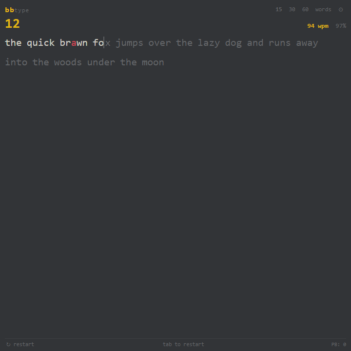
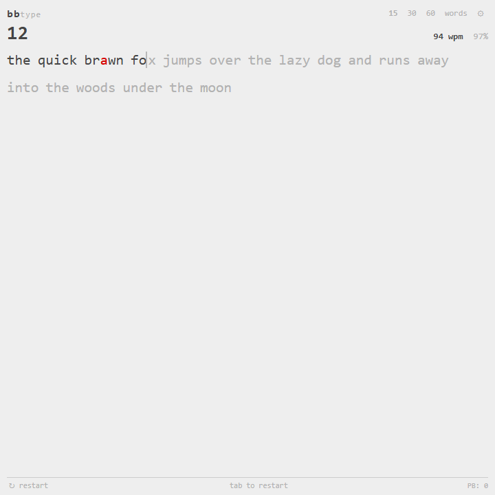
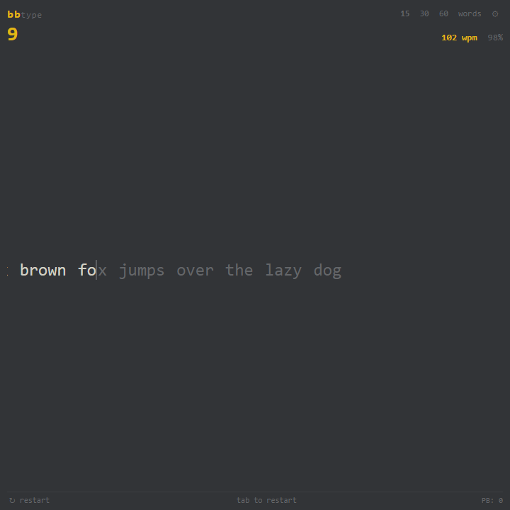
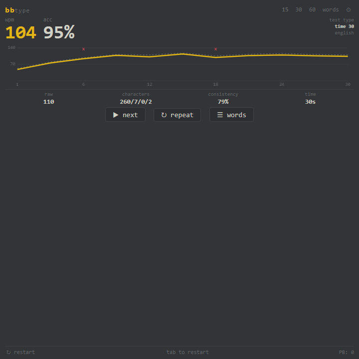
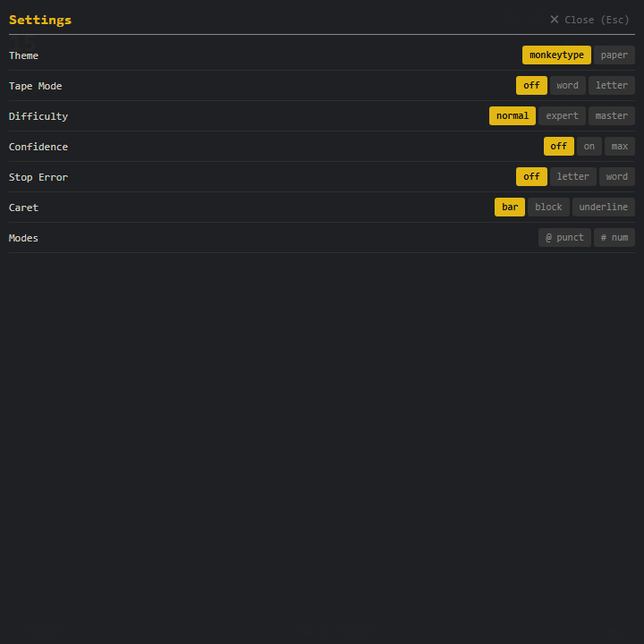

# BBType — Monkeytype for BlackBerry Q5

A fast, lightweight, zero-dependency, and offline typing speed test built specifically for the **BlackBerry Q5** (and other BB10 physical keyboard devices like the Q10, Classic, and Passport).

---

## 📸 Screenshots

| Classic Monkeytype (Dark) | Official Paper Theme (Light) |
| :---: | :---: |
|  |  |

| Tape Mode (Horizontal Scroll) | Results & 2D Canvas Analytics |
| :---: | :---: |
|  |  |

  <b>In-App Settings Drawer</b> 
  

---

## 📦 What's Included

- **`BBType.apk`** (~25 KB): Standalone Android application package, signed and compatible with the BlackBerry 10 Android 4.3 runtime (API 18+).
- **`index.html`**: Standalone, zero-dependency HTML file that can also be run directly in the BB10 native browser.

---

## ⚡ Features Tailored for BlackBerry Q5

- **Screen Optimization**: Tailored for the 1:1 square **720×720** display.
- **Physical Keyboard Support**:
  - **`Space`**: Submits current word.
  - **`Backspace`**: Erases characters; steps back into previous words to fix mistakes.
  - **`Tab`** or **`Enter`**: Instant restart.
  - **`Esc`**: Toggles settings menu.
- **Dynamic Character Lighting**: Real-time feedback per keystroke.
- **Themes**:
  - **Monkeytype (Default)**: Charcoal `#323437` with gold accents `#e2b714`.
  - **Paper**: Official monochrome `#eeeeee` background, `#444444` dark charcoal text, `#b2b2b2` untyped text, and `#d70000` errors.
- **Tape Mode**: Single-line horizontal ticker tape presentation with smooth `word` or `letter` scrolling.
- **Monkeytype Results Screen**:
  - Hero **WPM** and **Accuracy %**.
  - **2D Canvas Performance Graph**: Real-time Net WPM curve, Raw WPM dashed curve, and error crosses ($\times$).
  - **4-Column Breakdown**: `raw`, `characters (correct/incorrect/extra/missed)`, `consistency %`, and `time`.
  - **Words History**: Toggleable breakdown of every typed word with error strikethroughs.
- **Modes**: 15s, 30s, 60s timed tests, 25, 50, 100 word counts, `@ punct` (punctuation), and `# num` (numbers).
- **Difficulty Modes**: Normal, Expert (fails on word typo), Master (fails on any single incorrect keystroke).
- **Confidence Modes**: Off, On, Max (backspace locked).
- **Caret Styles**: Bar, Block, Underline.
- **Personal Best (PB)**: Automatically tracked and saved locally per test mode.
- **100% Offline**: Zero external CDNs, zero internet connection required.

---

## 🚀 How to Install on BlackBerry Q5

### Step 1: Enable Sideloading on your Q5
1. Go to **Settings** on your BlackBerry.
2. Tap **App Manager** > **Installing Apps**.
3. Toggle **Allow apps from other sources to be installed** to **ON**.

### Step 2: Transfer `BBType.apk` to your Phone
Choose any convenient method:
- **USB Cable**: Connect your Q5 to your PC via USB in **Media Transfer** or **USB Mass Storage** mode, and drag `BBType.apk` into the **Downloads** or **Documents** folder.
- **MicroSD Card**: Copy `BBType.apk` onto your microSD card and insert it into the Q5.
- **Bluetooth**: Send `BBType.apk` directly over Bluetooth from your PC to your phone.

### Step 3: Install the App
1. Open the **File Manager** app on your BlackBerry Q5.
2. Navigate to where you saved `BBType.apk`.
3. Tap on **`BBType.apk`** and select **Install** at the top right.
4. Launch **BBType** from your home screen and start typing!
